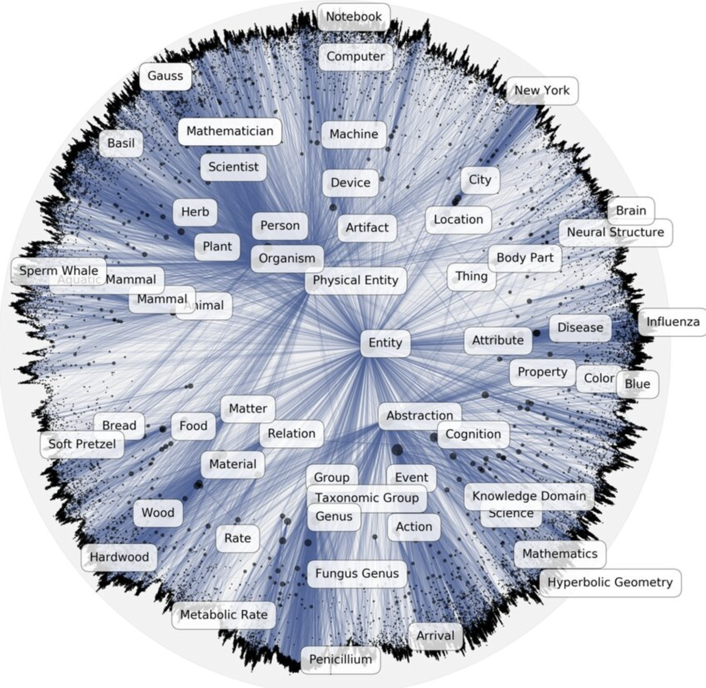

<style>
/* Classroom size: type about 1.5x the skill default (body 34 px instead of 21 px). */
section {
  --fs: 34px;
  --fs-lead: 32px;
  --fs-title: 44px;
  --fs-small: 24px;
  --fs-code: 26px;
  padding: 92px 50px 52px 57px;
}
section > h2 { top: 15px; line-height: 54px; }
section > h2::before { height: 54px; width: 12px; left: -26px; }
section > h2 + p { line-height: 1.36; margin: 0 0 12px -8px; max-width: 1180px; }
section .box { padding: 18px 28px; margin: 0 0 16px; }
section .box[data-tab] { margin-top: 30px; padding-top: 38px; }
section .box[data-tab]::before { font-size: 28px; height: 48px; line-height: 48px; top: -25px; }
section .tag, section .part[data-tag]::before { font-size: 24px; }
section .figtitle { font-size: 24px; margin-bottom: 8px; }
section .ref { font-size: 15px; bottom: 30px; }
section > footer, section::after { font-size: 14px; }
section .tri { border-width: 15px 0 15px 22px; }
section .cols.flow { grid-template-columns: minmax(0, 1fr) 30px minmax(0, 1fr); }
section .parts { margin: 64px 0 140px; }
section .part[data-tag]::before { bottom: calc(100% + 10px); }
section .pin { padding-top: 56px; }
section .pin::before { height: 44px; }
section iframe.anim { border: 0; display: block; margin: 0 auto; background: transparent; }
section .eq-xs .katex-display { font-size: 0.8em; }
section .parts.tight { margin: 52px 0 120px; }
section .pin br { display: block; }
section :not(.katex-display) > .katex { font-size: 1.04em; }
section .katex .why { font-size: 0.9em; }
section pre { padding: 14px 26px; line-height: 1.55; flex-shrink: 0; }
section th, section td { padding: 6px 18px; }
section table { margin-bottom: 14px; }
section.divider > h2 { font-size: 56px; }
section.divider .crumb { font-size: 26px; }
section.agenda ol > li { font-size: 52px; }
</style>

<!-- MOCK v2 (2026-11-03). Classroom-size type, two columns (text left, figure right). The lab QR is a placeholder; the
     growth slide is one frame of the planned animation. Wireframe: review/WIREFRAME.md. Build: python3 figures/make_figures.py;
     python3 ~/.claude/skills/slide-math/tools/check.py m08-embedding.md -->

<!-- _class: title -->
<!-- _paginate: false -->
<!-- _footer: "" -->

# Embedding

## from words to <span class="hot">networks</span>

Module 8: word2vec, hyperbolic and spectral embeddings

<p class="by">Sadamori Kojaku</p>

---

<!-- _class: agenda -->

## Outline

1. From words to nodes
2. Hyperbolic embedding
3. Spectral embedding

---

<!-- _class: divider -->

<p class="crumb">Embedding</p>

## From words to nodes

---

## Hand-made node features

Prediction models need a vector of numbers for every node, and for networks these numbers have been designed by hand.

<div class="cols c11 mid">
<div>

- degree $k_i$
- number of triangles $t_i$
- return probability $(\mathbf P^t)_{ii}$ of a random walk
- <span class="key">each task needs a new choice of features</span>

</div>
<div class="fig">


</div>
</div>

---

## Representation learning

Representation learning trains the node vectors $\vb x_i \in \R^d$ on data instead of designing them by hand.

<div class="fig">


</div>

- the vectors feed any model: a classifier, a clustering method, a link predictor
- the training signal comes from the network itself, without labels

---

## A detour through text

Next is a detour: word2vec is a method for text, and DeepWalk reuses it for networks later in this part.

<div class="cols c11 mid">
<div>

- word2vec learns a vector for every word of a text
- a random walk is a sequence of nodes, which can be read as a text
- <span class="key">we return to networks at DeepWalk</span>

</div>
<div class="fig">


</div>
</div>

---

## word2vec: words as vectors

word2vec (Mikolov et al. 2013) gives every word a vector, so that words used in similar contexts get close vectors.

<div class="cols c11 mid">
<div>

<div class="box eq-sm">

$$\begin{aligned} & \vb x_{\text{king}} - \vb x_{\text{man}} + \vb x_{\text{woman}} \\ & \approx \vb x_{\text{queen}} \end{aligned}$$

</div>

- a relation between words is a direction
- meaning is compared by linear algebra

</div>
<div class="fig">


</div>
</div>

<div class="ref">Mikolov, T., Chen, K., Corrado, G., & Dean, J. (2013). Efficient estimation of word representations in vector space. arXiv:1301.3781.</div>

---

## Prediction from context

word2vec predicts a word from a nearby word; every word has a query vector $\vb u$ and a key vector $\vb v$.

<div class="fig">


</div>

- a pair $(i, j)$ that appears in the text gets a high score $\vb u_i^\top \vb v_j$

---

## Training by contrast

A real pair (label 1) is pulled together and a random pair (label 0) is pushed apart.

<div class="cols c11 mid">
<div>

| input $i$ | other $j$ | label $y$ |
|---|---|---|
| <mark>favors</mark> | <mark>prepared</mark> | 1 |
| favors | water | 0 |
| only | mind | 1 |
| only | stone | 0 |

</div>
<div class="fig">


</div>
</div>

<div class="box eq-sm">

$$\Pr(y=1 \mid i, j) = \sigma(\vb u_i^\top \vb v_j) \quad \ell = -\log \sigma(\vb u_i^\top \vb v_j) - \log \sigma(-\vb u_i^\top \vb v_{j'})$$

</div>

---

## word2vec in motion

A window slides over the text, every position gives pairs, and the pairs move the vectors.

<div class="fig">
<iframe class="anim" src="anim/skipgram.html" width="1130" height="516"></iframe>
</div>

<div class="ref">Animation: skip-gram with 2 random pairs per real pair, 12 words, window of one word on each side. Only the query vectors u are drawn.</div>

---

## Walks as sentences

A random walk on a network is a sequence of nodes, in the same way that a sentence is a sequence of words.

<div class="cols c11 mid">
<div>

| text | network |
|---|---|
| word | node |
| sentence | random walk |
| nearby words | nodes close together in a walk |

</div>
<div class="fig">


</div>
</div>

---

## DeepWalk (Perozzi et al. 2014)

DeepWalk trains word2vec on random walks, with nodes in place of words.

<div class="fig">


</div>

- every node $i$ gets a query vector $\vb u_i$ and a key vector $\vb v_i$; $\vb u_i$ is its embedding
- settings: walks per node, walk length, window size; node2vec biases the walk with $p$ and $q$

<div class="ref">Perozzi, B., Al-Rfou, R., & Skiena, S. (2014). DeepWalk: online learning of social representations. KDD.</div>

---

## The walk rule sets what is close

Nodes that appear together in walks get close vectors, so a different walk rule gives a different embedding.

<div class="cols c32">
<div>

<div class="box">

**Plain walk**: move to a random neighbor

$$\Pr(i \to j) = A_{ij} / k_i$$

</div>

Another rule is a **walk with restart** (personalized PageRank): return to the start node $s$ with probability $\alpha$.

<div class="eq-sm">

$$\Pr(i \to j) = \alpha\,[\,j = s\,] + (1-\alpha)\,A_{ij} / k_i$$

</div>

</div>
<div class="fig">


</div>
</div>

---

## Lab: character embeddings

In the lab notebook, walkers run on the Les Misérables co-appearance network and word2vec embeds the characters.

<div class="cols c11">
<div>

- the walk simulator and the word2vec call are given
- choose a character and list the closest vectors
- plot the 77 characters in two dimensions

<div class="box grey">

QR code and short link <span class="tag">placeholder</span>

</div>
</div>
<div class="fig">


<div class="cap">

Valjean (lavender) and his 10 closest characters (cyan).

</div>
</div>
</div>

---

## Lab task: personalized PageRank walk

Implement a walk that restarts at the start node with probability $\alpha$.

```python
def ppr_walk(G, start, length, alpha, rng):
    walk = [start]
    # TODO: with probability alpha, go back to `start`;
    #       otherwise move to a random neighbor
    return walk
```

<div class="cols c11 mid">
<div>

- closest characters to $s$ for $\alpha = 0.05$ and $\alpha = 0.5$?
- how do they differ from the plain walk?

</div>
<div class="fig">


</div>
</div>

---

<!-- _class: divider -->

<p class="crumb">Embedding</p>

## Hyperbolic embedding

---

## Popularity and similarity

Papadopoulos et al. (2012) add similarity to preferential attachment.

<div class="fig">


</div>

- popularity: an earlier node has had more time to collect links
- similarity: nodes that are alike are placed close to each other

<div class="ref">Papadopoulos, F. et al. (2012). Popularity versus similarity in growing networks. Nature, 489, 537–540.</div>

---

## Growth rule of the model

Node $t$ gets the radius $\ln t$ and a random angle, and links to its $m$ closest nodes.

<div class="cols c11 mid">
<div>

<div class="box eq-sm">

$$r_t = \ln t$$

$$\theta_t \sim \mathrm{Uniform}[0, 2\pi)$$

link to the $m$ nodes $s < t$ with the smallest $s\,\theta_{st}$

</div>

- $\theta_{st}$: angle between $s$ and $t$

</div>
<div class="fig">
<iframe class="anim" src="anim/growth.html" width="540" height="506"></iframe>
</div>
</div>

---

## Observed degree mixes two effects

The observed degree mixes popularity with the size of the community.

<div class="cols c11">
<div>

<div class="parts tight eq-sm">
<div class="part">

$$k_i \;\propto$$

</div>
<div class="part" data-tag="popularity">

$$\hl{\kappa_i}$$

<div class="pin">

hidden<br>degree

</div>
</div>
<div class="part">

$$\times$$

</div>
<div class="part" data-tag="similarity">

$$\hlc{n_i}$$

<div class="pin">

community<br>size

</div>
</div>
</div>

- $k = 6$: a small $\kappa$ in the large community, a large $\kappa$ in the small one
- <span class="key">the node in the small community attracts links more strongly</span>

</div>
<div class="fig">


</div>
</div>

---

## Exponential growth of hyperbolic space

In the hyperbolic plane of curvature $-1$, the circumference of a circle grows exponentially with its radius.

<div class="cols c11 mid">
<div>

<div class="box eq-sm">

$$C_{\text{hyp}}(r) = 2\pi \sinh r \approx \pi e^{r}$$

$$C_{\text{Euclid}}(r) = 2\pi r$$

</div>

- the area $2\pi(\cosh r - 1)$ also grows as $e^{r}$
- the radius is the logarithm of the number of nodes that fit

</div>
<div class="fig">


</div>
</div>

---

## Hyperbolic space as a continuous tree

Hyperbolic space is the continuous version of a tree.

<div class="cols flow c11 mid">
<div class="fig">


</div>

<span class="tri"></span>

<div class="fig">


<div class="cap">

Poincaré disk, depth $d$ at distance $0.9\,d$.

</div>
</div>
</div>

- depth $d$ of a tree holds $b^d$ nodes; hyperbolic space grows in the same way

---

## WordNet in the Poincaré disk

General words lie near the center and specific words near the boundary.

<div class="cols c11 mid">
<div>

- center: general words
- boundary: specific words
- the hierarchy of 80,000 nouns fits in a disk of two dimensions

</div>
<div class="fig">



</div>
</div>

<div class="ref">Image: Poincaré embedding of WordNet nouns (Nickel & Kiela 2017; source to be confirmed).</div>

---

<!-- _class: divider -->

<p class="crumb">Embedding</p>

## Spectral embedding

---

## Compressing a matrix

A spectral embedding keeps an $N \times d$ matrix $\mathbf U$ that rebuilds the $N \times N$ adjacency matrix as closely as possible.

<div class="cols c11 mid">
<div>

<div class="box eq-sm" data-tab="Objective">

$$\min_{\mathbf U \in \R^{N \times d}} \ \| \mathbf A - \mathbf U \mathbf U^{\top} \|_F$$

</div>

- PCA compresses a data matrix in the same way
- here the matrix is $\mathbf A$ and the vectors are its eigenvectors

</div>
<div class="fig">


</div>
</div>

---

## Eigendecomposition

A symmetric matrix is a weighted sum of outer products of its eigenvectors.

<div class="box">

$$\mathbf A = \sum\nolimits_{k=1}^{N} \lambda_k \, \mathbf u_k \mathbf u_k^{\top}$$

<div class="note">

$\mathbf u_k$: unit eigenvector with eigenvalue $\lambda_k$; $\mathbf u_k \mathbf u_k^{\top}$ is an $N \times N$ matrix.

</div>
</div>

<div class="fig">
<div class="figtitle">

Zachary's karate club: $\mathbf A$ and its first three terms

</div>


</div>

---

## Keeping the large terms

Keeping the $d$ terms with the largest $|\lambda_k|$ gives the rank-$d$ approximation $\mathbf A_d$.

<div class="box eq-sm">

$$\mathbf A_d = \sum\nolimits_{k=1}^{d} \lambda_k \, \mathbf u_k \mathbf u_k^{\top}$$

</div>

<div class="fig">
<iframe class="anim" src="anim/reconstruct.html" width="1170" height="366"></iframe>
</div>

---

## Optimality of the truncation

$\mathbf A_d$ is the closest matrix of rank at most $d$ to $\mathbf A$ in the Frobenius norm.

<div class="cols c11">
<div>

<div class="def">

$\| \mathbf M \|_F = \sqrt{\sum_{i,j} M_{ij}^2}$

</div>

<div class="box eq-sm" data-tab="Eckart–Young–Mirsky">

$$\mathbf A_d = \arg\min_{\operatorname{rank}(\mathbf B) \le d} \| \mathbf A - \mathbf B \|_F$$

$$\| \mathbf A - \mathbf A_d \|_F^{\,2} = \sum_{k > d} \lambda_k^2$$

</div>

- <span class="key">the error is the sum of the squared eigenvalues that are dropped</span>

</div>
<div class="fig">


</div>
</div>

<div class="ref">Eckart, C., & Young, G. (1936). The approximation of one matrix by another of lower rank. Psychometrika, 1, 211–218.</div>

---

## Derivation of the truncation error

Write $\mathbf B = \sum_{k \le d} \sigma_k \vb q_k \vb q_k^\top$ with orthonormal axes $\vb q_k$; minimize over $\sigma_k$, then over $\vb q_k$.

<div class="box eq-xs">

$$
\begin{aligned}
\| \mathbf A - \mathbf B \|_F^{2} &= \| \mathbf A \|_F^{2} - 2 \sum\nolimits_{k \le d} \sigma_k\, \vb q_k^\top \mathbf A \vb q_k + \sum\nolimits_{k \le d} \sigma_k^2 && \why{$\vb q_k^\top \vb q_l = \delta_{kl}$}\\
\partial / \partial \sigma_k = 0 \ &\Rightarrow\ \sigma_k = \vb q_k^\top \mathbf A \vb q_k && \why{one weight at a time}\\
\| \mathbf A - \mathbf B \|_F^{2} &= \| \mathbf A \|_F^{2} - \sum\nolimits_{k \le d} (\vb q_k^\top \mathbf A \vb q_k)^2 \\
\max_{\| \vb q_k \| = 1} (\vb q_k^\top \mathbf A \vb q_k)^2 \ &\Rightarrow\ \mathbf A \vb q_k = \lambda_k \vb q_k && \why{Lagrange multiplier}\\
\| \mathbf A - \mathbf A_d \|_F^{2} &= \sum\nolimits_{k} \lambda_k^2 - \sum\nolimits_{k \le d} \lambda_k^2 = \sum\nolimits_{k > d} \lambda_k^2 && \why{$\| \mathbf A \|_F^{2} = \sum_k \lambda_k^2$}
\end{aligned}
$$

</div>

- the axes are eigenvectors of $\mathbf A$, and $\vb q_k^\top \mathbf A \vb q_k = \lambda_k$; <span class="key">keeping the $d$ largest $\lambda_k^2$ gives the smallest error</span>
---

## Matrices that represent a network

The matrix to decompose is a choice, and the Laplacian and the normalized Laplacian both come from graph cuts.

| name | definition |
|---|---|
| adjacency matrix | $\mathbf A$, with $A_{ij} = 1$ if $i$ and $j$ are linked |
| degree matrix | $\mathbf D = \operatorname{diag}(k_1, \dots, k_N)$ |
| Laplacian | $\mathbf L = \mathbf D - \mathbf A$ |
| normalized Laplacian | $\mathbf L_{\mathrm{sym}} = \mathbf I - \mathbf D^{-1/2} \mathbf A \mathbf D^{-1/2}$ |

- for $\mathbf A$, keep the eigenvectors with the largest eigenvalues
- for $\mathbf L$ and $\mathbf L_{\mathrm{sym}}$, keep those with the smallest eigenvalues

---

## Cutting a network in two

A cut splits the nodes into $S$ and $T$; Ratio Cut divides the cut size by the group sizes.

<div class="box eq-sm">

$$\mathrm{cut}(S,T) = \sum_{i \in S} \sum_{j \in T} A_{ij}$$

$$\mathrm{RatioCut}(S,T) = \mathrm{cut}(S,T) \left( \frac{1}{|S|} + \frac{1}{|T|} \right)$$

</div>

<div class="cols c11">
<div class="fig">


<div class="cap">

$S = \{p\}$: $1 \times (1 + \tfrac{1}{10}) = 1.10$

</div>
</div>
<div class="fig">


<div class="cap">

$S$ = left clique and $p$: $1 \times (\tfrac{1}{6} + \tfrac{1}{5}) = 0.37$

</div>
</div>
</div>

---

## Group indicator vector

A cut is encoded by a vector $\vb x$ that takes one value on $S$ and another on $T$.

<div class="cols c11 mid">
<div>

<div class="box eq-sm">

$$x_i = \begin{cases} \ \ \sqrt{|T|/|S|} & i \in S \\ -\sqrt{|S|/|T|} & i \in T \end{cases}$$

</div>

</div>
<div class="fig">
<div class="figtitle">

$\vb x$ for the second cut: $|S| = 6$, $|T| = 5$

</div>


</div>
</div>

- $\sum_i x_i = 0$: shifting $\vb x$ by a constant does not change $\vb x^\top \mathbf L \vb x$, so the mean is fixed (and $\vb x \propto \mathbf 1$ is out)
- $\sum_i x_i^2 = N$: fixes the scale; without it $\vb x = \mathbf 0$ is the trivial minimum

---

## Ratio Cut as a quadratic form

With the indicator $\vb x$, the Ratio Cut is $\vb x^\top \mathbf L \vb x / N$, where $\mathbf L = \mathbf D - \mathbf A$.

<div class="cols c32">
<div>

<div class="box eq-xs">

$$
\begin{aligned}
\vb x^\top \mathbf L \vb x &= \tfrac{1}{2} \sum_{i,j} A_{ij} (x_i - x_j)^2\\
&= \mathrm{cut}(S,T)\,(x_S - x_T)^2\\
&= \mathrm{cut}(S,T)\,\frac{N^2}{|S|\,|T|}\\
&= N \,\mathrm{RatioCut}(S,T)
\end{aligned}
$$

</div>

- $x_i - x_j$ is $0$ inside a group, $\pm (x_S - x_T)$ between groups
- <span class="key">only cut edges give a nonzero term</span>

</div>
<div class="fig">


<div class="cap">

$S$ = left clique and $p$; the outlined cells of $\mathbf A$ are the cut edge.

</div>
</div>
</div>

---

## Relaxation to real values

Letting $\vb x$ take any real value turns the problem into one that can be solved.

<div class="box eq-xs" data-tab="Original">

$$
\begin{aligned}
& \min_{\vb x} \ \vb x^\top \mathbf L \vb x \\
& \text{s.t.} \ \ \vb x^\top \mathbf 1 = 0, \ \ \vb x^\top \vb x = N, \ \ \hl{x_i \in \{\sqrt{|T|/|S|},\, -\sqrt{|S|/|T|}\}}
\end{aligned}
$$

</div>

<div class="box eq-xs" data-tab="Relaxed: drop the highlighted constraint">

$$\min_{\vb x \in \R^N} \ \vb x^\top \mathbf L \vb x \quad \text{s.t.} \quad \vb x^\top \mathbf 1 = 0, \ \ \vb x^\top \vb x = N$$

</div>

- the minimum can only decrease; the groups are read from the signs of $\vb x$

---

## Solving the relaxed problem

The Lagrangian turns the constrained minimization into an eigenvalue problem.

<div class="cols c32">
<div>

<div class="box eq-xs">

$$
\begin{aligned}
\mathcal L(\vb x, \lambda) &= \vb x^\top \mathbf L \vb x - \lambda\,(\vb x^\top \vb x - N)\\
\partial \mathcal L / \partial \vb x &= 2 \mathbf L \vb x - 2 \lambda \vb x = \mathbf 0\\
&\Longrightarrow \ \mathbf L \vb x = \lambda \vb x, \quad \vb x^\top \mathbf L \vb x = \lambda N
\end{aligned}
$$

</div>

- the cost is $\lambda N$, so a small $\lambda$ is better
- $\lambda = 0$ belongs to $\vb x \propto \mathbf 1$, which $\vb x^\top \mathbf 1 = 0$ excludes
- <span class="key">the solution is the eigenvector of the second smallest eigenvalue</span>

</div>
<div class="fig">


</div>
</div>

---

## Second eigenvector of the Laplacian

On Zachary's karate club, the sign of the second eigenvector of $\mathbf L$ gives the two factions.

<div class="cols c12 mid">
<div class="fig">


</div>
<div class="fig">
<p class="figtitle">Entries of the second eigenvector, sorted; <mark>Mr. Hi's faction</mark> and <mark class="alt">the officer's faction</mark></p>


</div>
</div>

- the sign matches the faction for 32 of the 34 members (outlined: 3 and 9)

---

## Normalized Cut

Normalized Cut divides the cut size by the group volumes.

<div class="cols c11">
<div>

<div class="def">

volume $V_S = \sum_{i \in S} k_i$ counts edge ends, not nodes; $V = V_S + V_T = 2m$

</div>

<div class="box eq-xs">

$$\mathrm{NCut}(S,T) = \mathrm{cut}(S,T) \left( \frac{1}{V_S} + \frac{1}{V_T} \right)$$

$$x_i = \begin{cases} \ \ \sqrt{V_T / V_S} & i \in S \\ -\sqrt{V_S / V_T} & i \in T \end{cases}$$

</div>

</div>
<div class="fig">
<div class="figtitle">

$\vb x$ for the second cut: $V_S = 23$, $V_T = 21$

</div>


</div>
</div>

- $\vb x^\top \mathbf D \mathbf 1 = \sum_i k_i x_i = 0$ and $\vb x^\top \mathbf D \vb x = \sum_i k_i x_i^2 = V$
- <span class="key">sizes are counted in edge ends, so $\mathbf D$ weights each node by its degree</span>

---

## Normalized Cut as a quadratic form

The same expansion gives $\vb x^\top \mathbf L \vb x = V \, \mathrm{NCut}(S,T)$.

<div class="cols c32">
<div>

<div class="box eq-xs">

$$
\begin{aligned}
\vb x^\top \mathbf L \vb x &= \tfrac{1}{2} \sum_{i,j} A_{ij} (x_i - x_j)^2\\
&= \mathrm{cut}(S,T)\,(x_S - x_T)^2\\
&= \mathrm{cut}(S,T)\,\frac{V^2}{V_S\,V_T}\\
&= V \,\mathrm{NCut}(S,T)
\end{aligned}
$$

</div>

- $x_S - x_T = \sqrt{V_T / V_S} + \sqrt{V_S / V_T} = V / \sqrt{V_S V_T}$
- <span class="key">same blocks as Ratio Cut, other values</span>

</div>
<div class="fig">


<div class="cap">

Same cut, with $V_S = 23$ and $V_T = 21$.

</div>
</div>
</div>

---

## Relaxation of Normalized Cut

The relaxation is the one used for Ratio Cut, with $\mathbf D$ in the constraints.

<div class="box eq-xs" data-tab="Original">

$$
\begin{aligned}
& \min_{\vb x} \ \vb x^\top \mathbf L \vb x \\
& \text{s.t.} \ \ \vb x^\top \mathbf D \mathbf 1 = 0, \ \ \vb x^\top \mathbf D \vb x = V, \ \ \hl{x_i \in \{\sqrt{V_T / V_S},\, -\sqrt{V_S / V_T}\}}
\end{aligned}
$$

</div>

<div class="box eq-xs" data-tab="Relaxed: drop the highlighted constraint">

$$\min_{\vb x \in \R^N} \ \vb x^\top \mathbf L \vb x \quad \text{s.t.} \quad \vb x^\top \mathbf D \mathbf 1 = 0, \ \ \vb x^\top \mathbf D \vb x = V$$

</div>

- the original minimum is $V \cdot \mathrm{NCut}$; the groups are read from the signs of $\vb x$

---

## Solving the relaxed problem for Normalized Cut

The Lagrangian gives a generalized eigenvalue problem, $\mathbf L \vb x = \lambda \mathbf D \vb x$.

<div class="cols c32">
<div>

<div class="box eq-xs">

$$
\begin{aligned}
\mathcal L(\vb x, \lambda) &= \vb x^\top \mathbf L \vb x - \lambda\,(\vb x^\top \mathbf D \vb x - V)\\
\partial \mathcal L / \partial \vb x &= 2 \mathbf L \vb x - 2 \lambda \mathbf D \vb x = \mathbf 0\\
&\Longrightarrow \ \mathbf L \vb x = \lambda \mathbf D \vb x, \quad \vb x^\top \mathbf L \vb x = \lambda V
\end{aligned}
$$

</div>

- the cost is $\lambda V$, so a small $\lambda$ is better
- $\lambda = 0$ belongs to $\vb x \propto \mathbf 1$, which $\vb x^\top \mathbf D \mathbf 1 = 0$ excludes
- <span class="key">the solution is the eigenvector of the second smallest eigenvalue</span>

</div>
<div class="fig">


</div>
</div>

---

## From $\mathbf L \vb x = \lambda \mathbf D \vb x$ to the normalized Laplacian

The change of variable $\vb y = \mathbf D^{1/2} \vb x$ gives an ordinary eigenvalue problem.

<div class="box eq-xs">

$$
\begin{aligned}
\mathbf L \vb x = \lambda \mathbf D \vb x \ \ &\overset{\vb x = \mathbf D^{-1/2} \vb y}{\Longleftrightarrow} \ \ \mathbf L \mathbf D^{-1/2} \vb y = \lambda \mathbf D^{1/2} \vb y\\
&\Longleftrightarrow \ \ \mathbf D^{-1/2} \mathbf L \mathbf D^{-1/2} \vb y = \lambda \vb y && \why{multiply by $\mathbf D^{-1/2}$}\\
&\Longleftrightarrow \ \ \mathbf L_{\mathrm{sym}} \vb y = \lambda \vb y && \why{$\mathbf D^{-1/2} \mathbf L \mathbf D^{-1/2} = \mathbf I - \mathbf D^{-1/2} \mathbf A \mathbf D^{-1/2}$}
\end{aligned}
$$

</div>

- $\vb x^\top \mathbf D \vb x = V$ becomes $\vb y^\top \vb y = V$: the length of $\vb y$
- $\vb x^\top \mathbf D \mathbf 1 = 0$ becomes $\vb y^\top \mathbf D^{1/2} \mathbf 1 = 0$, and $\mathbf D^{1/2} \mathbf 1$ is the eigenvector of $\lambda = 0$, since $\mathbf L_{\mathrm{sym}} \mathbf D^{1/2} \mathbf 1 = \mathbf D^{-1/2} \mathbf L \mathbf 1 = \mathbf 0$
- <span class="key">$\vb y$ is the eigenvector with the second smallest eigenvalue, and $\vb x = \mathbf D^{-1/2} \vb y$</span>

---

## Pen and paper: from the cut to the Laplacian

Derive the Ratio Cut result and the Normalized Cut counterpart on paper (10 minutes).

<div class="cols c32 mid">
<div>

| question | task |
|---|---|
| Q1 | $\sum_i x_i = 0$ and $\sum_i x_i^2 = N$ |
| Q2 | $\vb x^\top \mathbf L \vb x = \tfrac{1}{2} \sum_{i,j} A_{ij} (x_i - x_j)^2$ |
| Q3 | $\vb x^\top \mathbf L \vb x = N\, \mathrm{RatioCut}$ |
| Q4 | Q1 to Q3 for Normalized Cut |
| Q5 | $\mathbf L \vb x = \lambda \mathbf D \vb x \Rightarrow \mathbf L_{\mathrm{sym}} \vb y = \lambda \vb y$ |

</div>
<div class="fig">


</div>
</div>

---

## Summary

- word2vec learns a vector per word from word pairs; DeepWalk applies it to random walks
  - the walk rule decides which nodes are close
- hyperbolic embedding places nodes by popularity (radius) and similarity (angle)
  - the space grows exponentially, as a tree does
- spectral embedding keeps the eigenvectors with the largest terms of $\mathbf A$
  - the Laplacian comes from the continuous relaxation of Ratio Cut; the normalized Laplacian, from Normalized Cut
